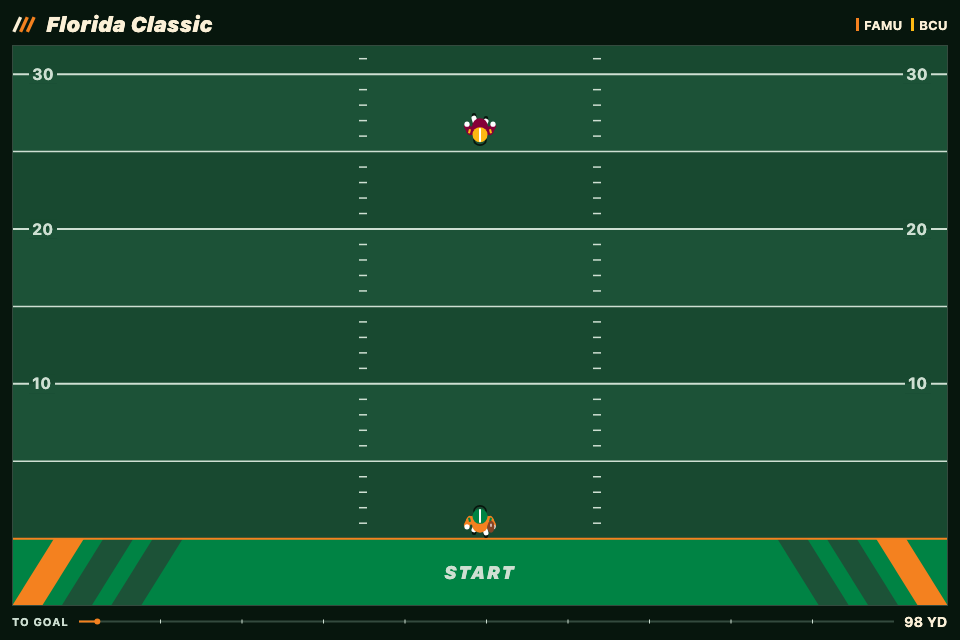
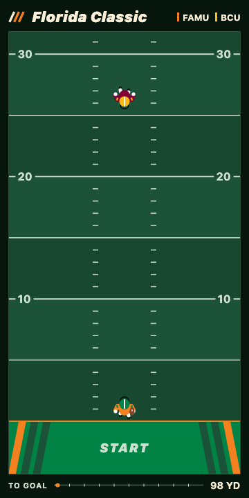
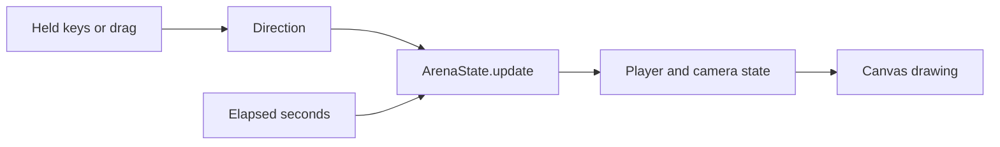

# Kotlin football game lab

Learn Kotlin and Compose Multiplatform by building a small football game for
Android, desktop, and iOS. Steer a FAMU runner past a BCU defender toward the
Rattlers end zone. Each lesson adds a working piece of the game and explains
how input, state, time, and Canvas drawing fit together.

The current game and full learning guide are on
[`develop`](https://github.com/GetRighhttt/Famu_Kotlin_Arena_Game/tree/develop).
`master` contains the original drawing and tap experiments.



<details>
<summary>See the portrait layout</summary>

<p>Rendered at 360 × 720 to show how the shared screen fits a narrow viewport.</p>


</details>

## Start here

Read the [learning guide](https://github.com/GetRighhttt/Famu_Kotlin_Arena_Game/blob/develop/README.md#start-here)
for prerequisites, exercises, and an explanation of how one frame moves from
input to the rendered screen. Some Kotlin basics help, including functions,
data classes, nullable values, and lambdas.

To run the current game, clone the repository and select `develop`.

```sh
git clone https://github.com/GetRighhttt/Famu_Kotlin_Arena_Game.git
cd Famu_Kotlin_Arena_Game
git switch develop
./gradlew :desktopApp:run
```

The project has been built with JDK 21. Use the included Gradle wrapper.
The first build needs internet access to download dependencies.

For Android, open the project in Android Studio with the Kotlin Multiplatform
plugin and run `androidApp` on a connected device or emulator. The project uses
Android SDK 36 and supports devices on API 26 or later. Build an APK with
`./gradlew :androidApp:assembleDebug`.

For iOS, use macOS and Xcode. Open `iosApp/NeonArena.xcodeproj`, select the
`NeonArena` scheme and an Apple Silicon simulator, then run. Physical devices
need your signing team configured in Xcode.

See the [setup and troubleshooting instructions](https://github.com/GetRighhttt/Famu_Kotlin_Arena_Game/blob/develop/README.md#run)
for SDK paths and test commands.

## Play the game

Use WASD or arrow keys on desktop. On a touchscreen, drag away from the initial
finger-down position and hold to steer. Return to that position to stop steering,
or release your finger. Mouse dragging works too. Tapping jumps the runner to
the tapped spot as a coordinate-learning shortcut.

The field scrolls automatically toward the Rattlers end zone. Avoid the chasing
BCU defender and reach the far goal line once the camera reveals the end zone.
A tackle or touchdown ends the run. Select Try again to restart.

## Follow the lessons

Each branch below is a runnable checkpoint. Open its link to browse the code,
or use `git switch` with its branch name after saving your local experiments.
Keep the [full guide](https://github.com/GetRighhttt/Famu_Kotlin_Arena_Game/blob/develop/README.md#learning-sequence)
open when trying older checkpoints, which contain earlier README versions.

| Checkpoint | What you learn |
| --- | --- |
| [`bayne/project-setup`](https://github.com/GetRighhttt/Famu_Kotlin_Arena_Game/tree/bayne/project-setup) | Platform launchers and a shared Compose screen |
| [`bayne/draw-arena`](https://github.com/GetRighhttt/Famu_Kotlin_Arena_Game/tree/bayne/draw-arena) | Canvas layout and drawing order |
| [`bayne/draw-player`](https://github.com/GetRighhttt/Famu_Kotlin_Arena_Game/tree/bayne/draw-player) | Coordinates, density, and shapes |
| [`bayne/tap-input`](https://github.com/GetRighhttt/Famu_Kotlin_Arena_Game/tree/bayne/tap-input) | Observable state and tap gestures |
| [`bayne/player-state`](https://github.com/GetRighhttt/Famu_Kotlin_Arena_Game/tree/bayne/player-state) | Data classes, extensions, and boundaries |
| [`bayne/color-scheme`](https://github.com/GetRighhttt/Famu_Kotlin_Arena_Game/tree/bayne/color-scheme) | Team colors and field markings |
| [`bayne/game-loop`](https://github.com/GetRighhttt/Famu_Kotlin_Arena_Game/tree/bayne/game-loop) | Frame timing, velocity, and elapsed seconds |
| [`bayne/keyboard-controls`](https://github.com/GetRighhttt/Famu_Kotlin_Arena_Game/tree/bayne/keyboard-controls) | Held keys, focus, and diagonal movement |
| [`bayne/touch-controls`](https://github.com/GetRighhttt/Famu_Kotlin_Arena_Game/tree/bayne/touch-controls) | Continuous steering from drag input |
| [`bayne/chasing-enemy`](https://github.com/GetRighhttt/Famu_Kotlin_Arena_Game/tree/bayne/chasing-enemy) | Direction vectors and pursuit |
| [`bayne/collisions`](https://github.com/GetRighhttt/Famu_Kotlin_Arena_Game/tree/bayne/collisions) | Circle contact, tackles, and restart |
| [`bayne/end-zone`](https://github.com/GetRighhttt/Famu_Kotlin_Arena_Game/tree/bayne/end-zone) | World coordinates, camera scrolling, and touchdown |
| [`bayne/gameday-presentation`](https://github.com/GetRighhttt/Famu_Kotlin_Arena_Game/tree/bayne/gameday-presentation) | Field paint and a fixed yardage display |
| [`bayne/learning-guide`](https://github.com/GetRighhttt/Famu_Kotlin_Arena_Game/tree/bayne/learning-guide) | Method explanations and a guide to the completed lessons |

Try each lesson's experiment by predicting the result, changing one value, and
running again. The [merged lesson stack](https://github.com/GetRighhttt/Famu_Kotlin_Arena_Game/stack/5)
records the later changes in order.

The current game follows this path on each frame. Read the
[frame walkthrough](https://github.com/GetRighhttt/Famu_Kotlin_Arena_Game/blob/develop/README.md#follow-one-frame)
for a worked example of the movement calculation.



## Check your changes

On `develop`, run the shared rule tests and desktop rendering tests.

```sh
./gradlew :shared:jvmTest :desktopApp:jvmTest
```

The tests cover movement, input, boundaries, collisions, camera progress, and
rendered frames. Desktop rendering tests save previews under
`desktopApp/build/reports/field-camera/`.

The source code is available under the [MIT license](LICENSE).
